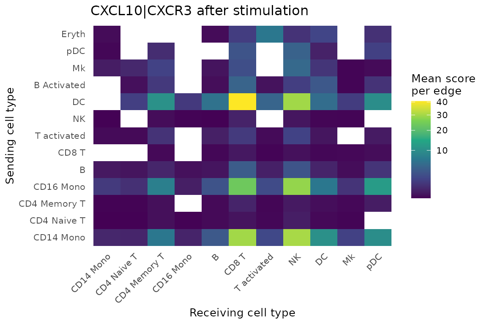

# Non-spatial tutorial: stimulated PBMCs

This tutorial runs NICHESv2 on scRNA-seq data with no spatial
coordinates: 13,999 human PBMCs, either untreated (`CTRL`) or stimulated
with interferon-beta (`STIM`). You’ll score LR signaling between sampled
cell pairs and compare the two conditions.

Without coordinates, nothing tells us which cells really touched.
NICHESv2 therefore samples cell pairs within each pair of cell types.
Treat the results as what cell types could signal to each other, not as
observed contacts.

With `n.cores = 2`, the slowest step takes about 1 minute and needs
about 4 GB of memory.

## Get the data

The dataset comes from
[SeuratData](https://github.com/satijalab/seurat-data), which isn’t on
CRAN. Run this once; the download is about 413 MB. SeuratData also
installs the Seurat package, so the first install can take a while.

``` r

install.packages(c("remotes", "SeuratObject"))
remotes::install_github("satijalab/seurat-data")
SeuratData::InstallData("ifnb")
```

``` r

library(NICHESv2)
library(data.table)
library(ggplot2)
library(SeuratObject)
library(SeuratData)

data("ifnb")
```

SeuratData objects keep the Seurat version they were saved with.
[`extract_NICHESInputs_Seurat()`](https://raredonlab.github.io/NICHESv2/reference/extract_NICHESInputs_Seurat.md)
reads both V4 and V5 objects, so you don’t need to update them first.

## Extract the inputs

``` r

inputs <- extract_NICHESInputs_Seurat(
  seurat.obj = ifnb,
  assay      = "RNA",
  layer      = "counts",
  verbose    = FALSE
)
dim(inputs$count.mtx)
#> [1] 14053 13999

table(inputs$meta.data$stim)
#> 
#> CTRL STIM 
#> 6548 7451
```

Two metadata columns matter here: `stim` holds the condition, and
`seurat_annotations` holds 13 cell types.

## Build the NICHESObject

`sample.col = "stim"` builds edges separately within each condition, so
a `CTRL` cell is never paired with a `STIM` cell. Set it whenever your
data has several samples, donors or conditions. `cell.type.col` is
required in this mode, and the sampling is repeatable through `seed`,
which defaults to 42.

``` r

obj <- create_NICHESObject(
  count.mtx     = inputs$count.mtx,
  meta.data     = inputs$meta.data,
  LRM.db        = "connectomedb2025",
  species       = "human",
  mode          = "nonspatial",
  sample.col    = "stim",
  cell.type.col = "seurat_annotations",
  method        = "product",
  n.cores       = 2L,
  verbose       = FALSE
)
dim(obj)
#> cells genes edges  LRMs 
#> 13999 14053 87957  1047
```

Every edge stays within one condition:

``` r

obj$edge.meta[, .(edges = .N), by = .(Sending.stim, Receiving.stim)]
```

| Sending.stim | Receiving.stim |  edges |
|:-------------|:---------------|-------:|
| CTRL         | CTRL           | 40,962 |
| STIM         | STIM           | 46,995 |

## Compare the conditions

`$edge.meta` carries the condition and cell type of both cells on every
edge, so it joins directly onto the scores. The two conditions have
different numbers of edges, so this divides each total by that number.

``` r

edge.info <- obj$edge.meta[, .(
  edge,
  stim     = Sending.stim,
  sender   = Sending.seurat_annotations,
  receiver = Receiving.seurat_annotations
)]
scores <- merge(obj$edge.data[, .(edge, LRM, score)], edge.info, by = "edge")

n.edges <- edge.info[, .(n.edges = .N), by = stim]

by.condition <- scores[, .(total = sum(score)), by = .(LRM, stim)]
by.condition <- merge(by.condition, n.edges, by = "stim")
by.condition[, mean.per.edge := total / n.edges]

wide <- dcast(by.condition, LRM ~ stim, value.var = "mean.per.edge", fill = 0)
wide[, fold.change := (STIM + 0.01) / (CTRL + 0.01)]
wide[STIM > 0.5][order(-fold.change)][1:5]
```

| LRM          |  CTRL |  STIM | fold.change |
|:-------------|------:|------:|------------:|
| CCL8\|CCR1   | 0.003 | 3.272 |     259.706 |
| CCL8\|CCR5   | 0.001 | 1.818 |     163.283 |
| CXCL11\|CCR5 | 0.000 | 0.596 |      57.817 |
| CXCL10\|TLR4 | 0.009 | 0.929 |      48.417 |
| ISG15\|ITGB2 | 0.078 | 4.058 |      46.228 |

Interferon-induced chemokines lead this list, which is what we’d expect
from this stimulation. Comparing raw scores between conditions is a
simple first look, and it doesn’t correct for differences in sequencing
depth.

## Follow one signal

CXCL10 is a classic interferon-induced chemokine, and CXCR3 is its
receptor. This finds the cell-type pairs that carry the strongest
`CXCL10|CXCR3` signal after stimulation.

``` r

cxcl10 <- scores[LRM == "CXCL10|CXCR3" & stim == "STIM"]

pair.edges <- edge.info[stim == "STIM", .(n.edges = .N), by = .(sender, receiver)]
by.pair <- merge(
  cxcl10[, .(total = sum(score)), by = .(sender, receiver)],
  pair.edges,
  by = c("sender", "receiver")
)
by.pair[, mean.per.edge := total / n.edges]

ggplot(by.pair, aes(receiver, sender, fill = mean.per.edge)) +
  geom_tile() +
  scale_fill_viridis_c(name = "Mean score\nper edge", trans = "sqrt") +
  labs(x = "Receiving cell type", y = "Sending cell type",
       title = "CXCL10|CXCR3 after stimulation") +
  theme_minimal(base_size = 10) +
  theme(axis.text.x = element_text(angle = 45, hjust = 1),
        panel.grid = element_blank())
```



Dendritic cells and monocytes are the main senders, and CD8 T and NK
cells are the main receivers. Rare cell types such as `Eryth` rest on
few edges, so read their values with care.

## What differs from spatial mode

- [`add_neighborhood_composition()`](https://raredonlab.github.io/NICHESv2/reference/add_neighborhood_composition.md)
  stops in this mode, because neighbor cell types would only reflect the
  sampling.
- [`add_neighborhood_edge_agg()`](https://raredonlab.github.io/NICHESv2/reference/add_neighborhood_edge_agg.md)
  runs, but its neighbors are sampled partners, not physical neighbors.
- [`export_to_TissuePlex()`](https://raredonlab.github.io/NICHESv2/reference/export_to_TissuePlex.md)
  needs coordinates, so it applies to spatial data.

## Data source

The data are from Kang HM, Subramaniam M, Targ S, et al. Multiplexed
droplet single-cell RNA-sequencing using natural genetic variation. *Nat
Biotechnol*. 2018;36(1):89-94 (GEO: GSE96583). Cell-type labels are from
the Satija Lab.
