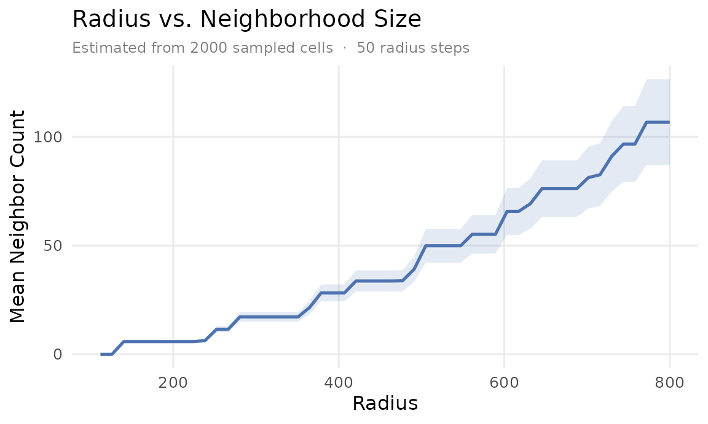
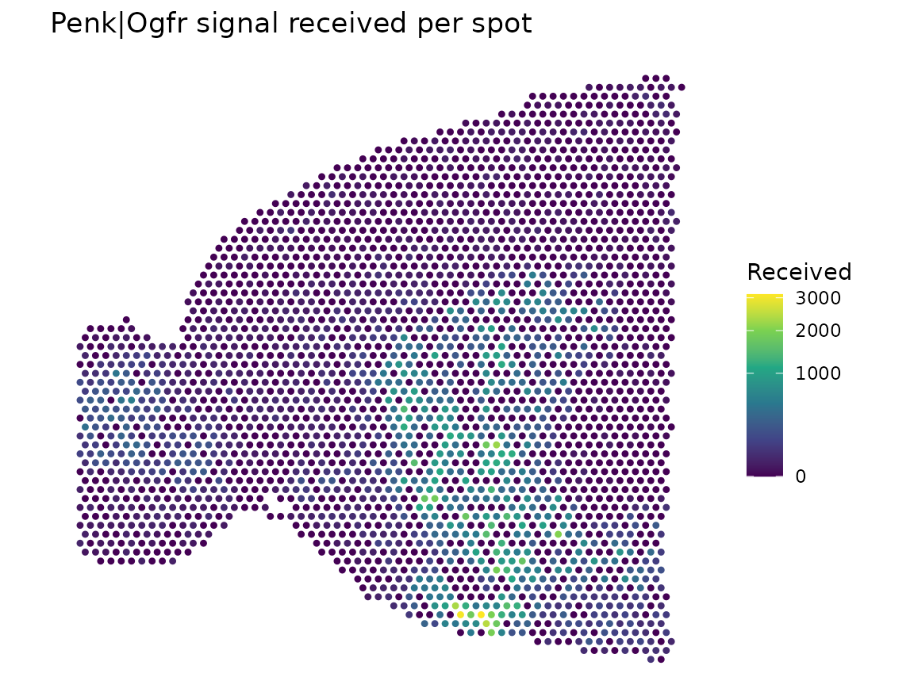
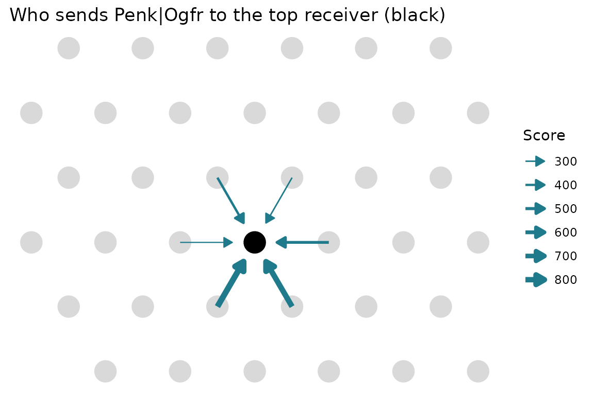

# Spatial tutorial: mouse brain

This tutorial runs a full spatial analysis on a public 10x Visium
section of the mouse brain: one anterior sagittal slice with 2,696
spots. You’ll score LR signaling between neighboring spots, map a signal
onto the tissue, and trace it back to the spots that sent it.

With `n.cores = 2`, the slowest step takes about 4 minutes.

## Get the data

The dataset comes from
[SeuratData](https://github.com/satijalab/seurat-data), which isn’t on
CRAN. Run this once; the download is about 143 MB. SeuratData also
installs the Seurat package, so the first install can take a while.

``` r

install.packages(c("remotes", "SeuratObject"))
remotes::install_github("satijalab/seurat-data")
SeuratData::InstallData("stxBrain")
```

Then load it. `stxBrain` holds four sections, and we use `anterior1`.

``` r

library(NICHESv2)
library(data.table)
library(ggplot2)
library(SeuratObject)
library(SeuratData)

data("anterior1")
```

SeuratData objects keep the Seurat version they were saved with.
[`extract_NICHESInputs_Seurat()`](https://raredonlab.github.io/NICHESv2/reference/extract_NICHESInputs_Seurat.md)
reads both V4 and V5 objects, so you don’t need to update them first.

## Extract the inputs

``` r

inputs <- extract_NICHESInputs_Seurat(
  seurat.obj = anterior1,
  assay      = "Spatial",
  layer      = "counts",
  verbose    = FALSE
)
dim(inputs$count.mtx)
#> [1] 31053  2696
```

Spatial coordinates sit in the image part of the Seurat object, so add
them to the metadata as `x` and `y`. Matching by barcode keeps every
spot aligned.

``` r

coords <- GetTissueCoordinates(anterior1)
inputs$meta.data$x <- coords[rownames(inputs$meta.data), "x"]
inputs$meta.data$y <- coords[rownames(inputs$meta.data), "y"]
```

## Choose a neighborhood

[`Explore_Radius_Neighborhood()`](https://raredonlab.github.io/NICHESv2/reference/Explore_Radius_Neighborhood.md)
shows how many neighbors each radius would give, before you build
anything.

``` r

radius.table <- Explore_Radius_Neighborhood(
  inputs$meta.data[, c("x", "y")],
  r.max = 800
)
```



The curve rises in steps because Visium spots sit on a hexagonal grid.
The first step is the ring of 6 touching spots. This tutorial uses
`k = 6`, which gives those immediate neighbors. Passing `rad` instead
would use a fixed radius.

This is one tissue section, so `sample.col` isn’t needed. Set it when
your data has several sections, so that no edges cross between them.

## Build the NICHESObject

Raw counts give scores on an absolute scale. With `"connectomedb2025"`
you don’t need to download anything else, and `species` must match your
data.

``` r

obj <- create_NICHESObject(
  count.mtx = inputs$count.mtx,
  meta.data = inputs$meta.data,
  LRM.db    = "connectomedb2025",
  species   = "mouse",
  mode      = "spatial",
  k         = 6L,
  method    = "product",
  n.cores   = 2L,
  verbose   = FALSE
)
dim(obj)
#> cells genes edges  LRMs 
#>  2696 31053 18500  3097
```

There’s one row in `$edge.data` for each non-zero (edge, LR pair) score:

``` r

nrow(obj$edge.data)
#> [1] 5191520
head(obj$edge.data, 3)
```

| edge                                   | LRM           | score | score.norm |
|:---------------------------------------|:--------------|------:|-----------:|
| AAACAAGTATCTCCCA-1\|AAACAAGTATCTCCCA-1 | Adam15\|Itgav |     4 |      0.002 |
| AAACAAGTATCTCCCA-1\|AAACAAGTATCTCCCA-1 | Adam23\|Itgav |     2 |      0.001 |
| AAACAAGTATCTCCCA-1\|AAACAAGTATCTCCCA-1 | Adamts1\|Lrp1 |     4 |      0.002 |

## Find the strongest signals

Summing across all edges shows which LR pairs dominate. Abundant genes
rise to the top, as they do with any magnitude-based score on raw
counts.

``` r

obj$edge.data[, .(total.score = sum(score), edges = .N), by = LRM][
  order(-total.score)][1:5]
```

| LRM         | total.score |  edges |
|:------------|------------:|-------:|
| Ppia\|Bsg   |  22,906,784 | 18,316 |
| App\|Aplp1  |  11,794,512 | 18,389 |
| Snca\|Aplp1 |   5,434,808 | 17,208 |
| Apoe\|Lrp1  |   4,286,950 | 17,273 |
| App\|Aplp2  |   4,006,297 | 17,971 |

## Aggregate by neighborhood

``` r

obj <- aggregate_NICHESObject(obj, verbose = FALSE)
agg <- obj$aggregations$neighborhood.edge.agg
```

This dataset has no cell-type labels, so we leave out `cell.type.col`
and skip the composition table.

## Map a signal onto the tissue

`Penk|Ogfr` is a useful example, because *Penk* is strongly enriched in
the striatum. `score.in.sum` adds up everything a spot receives from its
neighbors for this LR pair.

``` r

one.lrm <- agg[LRM == "Penk|Ogfr", .(cell, score.in.sum)]

plot.dt <- merge(
  obj$cell.meta[, .(cell, x, y)],
  one.lrm,
  by = "cell", all.x = TRUE
)
plot.dt[is.na(score.in.sum), score.in.sum := 0]

ggplot(plot.dt[order(score.in.sum)], aes(y, x, color = score.in.sum)) +
  geom_point(size = 0.9) +
  scale_x_continuous(NULL, labels = NULL) +
  scale_y_reverse(NULL, labels = NULL) +
  scale_color_viridis_c(name = "Received", trans = "sqrt") +
  coord_equal() +
  labs(title = "Penk|Ogfr signal received per spot") +
  theme_minimal(base_size = 11) +
  theme(panel.grid = element_blank())
```



## Trace a signal back to its senders

Because every edge is stored, you can see which neighbors sent the
signal to the strongest receiver. `share` is each sender’s part of the
total.

``` r

receiver <- one.lrm[which.max(score.in.sum), cell]

senders <- merge(
  obj$edge.data[LRM == "Penk|Ogfr", .(edge, score)],
  obj$edge.list[ReceivingCell == receiver & SendingCell != receiver],
  by = "edge"
)
senders[, share := score / sum(score)]
senders[order(-score), .(SendingCell, score, share)]
```

| SendingCell        | score | share |
|:-------------------|------:|------:|
| AGTACAGAAGCTTATA-1 |   858 | 0.275 |
| ACCGAGTCTCCTTATT-1 |   813 | 0.261 |
| GACCACACTTCCCTTT-1 |   474 | 0.152 |
| TAATACTAGAACAGAC-1 |   414 | 0.133 |
| GGGCAGTCAACGCCAA-1 |   297 | 0.095 |
| GAGATGGCTTTAATCA-1 |   261 | 0.084 |

``` r

spots  <- obj$cell.meta[, .(cell, x, y)]
center <- spots[cell == receiver]
nearby <- spots[abs(x - center$x) < 450 & abs(y - center$y) < 450]

arrows <- merge(senders, spots, by.x = "SendingCell", by.y = "cell")
arrows[, `:=`(x.end = x + 0.7 * (center$x - x),
              y.end = y + 0.7 * (center$y - y))]

ggplot() +
  geom_point(data = nearby, aes(y, x), color = "grey85", size = 7) +
  geom_point(data = center, aes(y, x), color = "black", size = 7) +
  geom_segment(
    data = arrows,
    aes(x = y, y = x, xend = y.end, yend = x.end, linewidth = score),
    color = "#1f7a8c",
    arrow = arrow(length = unit(2.5, "mm"), type = "closed")
  ) +
  scale_linewidth(range = c(0.4, 2), name = "Score") +
  scale_x_continuous(NULL, labels = NULL) +
  scale_y_reverse(NULL, labels = NULL) +
  coord_equal() +
  labs(title = "Who sends Penk|Ogfr to the top receiver (black)") +
  theme_minimal(base_size = 11) +
  theme(panel.grid = element_blank())
```



All of these edges share one receiver, so the differences come only from
how much *Penk* each neighbor expresses. Two neighbors supply more than
half of the signal.

## Export the edges

[`export_to_TissuePlex()`](https://raredonlab.github.io/NICHESv2/reference/export_to_TissuePlex.md)
needs the arrow package and writes one Parquet file.

``` r

out.file <- file.path(tempdir(), "edges.parquet")
export_to_TissuePlex(obj, output.path = out.file, celltype.col = NULL)
round(file.size(out.file) / 1e6)
#> [1] 43
```

The [export
guide](https://raredonlab.github.io/NICHESv2/articles/tissueplex-export.md)
shows what to do with that file.

## Data source

The data are from 10x Genomics, “Mouse Brain Serial Section 1
(Sagittal-Anterior)”, Space Ranger 1.0.0, licensed under [CC BY
4.0](https://creativecommons.org/licenses/by/4.0/).
